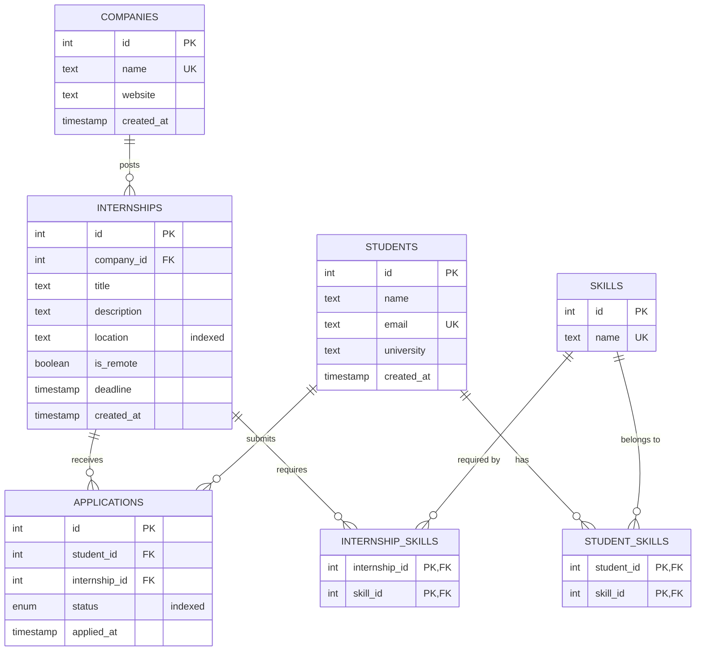

# TalentBridge - Task 4: PostgreSQL + Prisma + live frontend

Full-stack project: Express + Prisma + PostgreSQL backend and a Vite/React frontend that reads and writes the real database.

```
talentbridge/
  backend/    Express API, prisma/schema.prisma, prisma/migrations/, prisma/seed.ts, docker-compose.yml
  frontend/   Vite + React app (API base URL comes from .env)
  docs/ER.mmd Mermaid ER diagram (also embedded below)
```

## Quick start

```bash
# 1. Database (Docker). Or use a hosted Postgres and put its URL in backend/.env
cd backend
npm install
npm run db:up            # starts postgres:15 on :5432

# 2. Schema + data
cp .env.example .env     # DATABASE_URL, PORT, CORS_ORIGIN
npx prisma migrate dev   # applies the 4 committed migrations and generates the client
npm run db:seed          # realistic sample data (safe to re-run)

# 3. API
npm run dev              # http://localhost:4000  (GET /health)

# 4. Frontend (new terminal)
cd ../frontend
npm install
cp .env.example .env     # VITE_API_BASE_URL=http://localhost:4000/api
npm run dev              # http://localhost:5173
```

For hosted databases use `npx prisma migrate deploy` instead of `migrate dev`.

## Architecture (Task 3 layering preserved)

`routes -> controllers -> services -> Prisma`. Only `src/services/*` and `src/db/prisma.ts` import Prisma; routes and controllers have no database knowledge. Swapping the in-memory store for Prisma is therefore a service-layer change only.

## Endpoints

| Method | Path | Notes |
|---|---|---|
| GET/POST | `/api/companies` | list includes `_count.internships` |
| GET/PUT/DELETE | `/api/companies/:id` | |
| GET/POST | `/api/internships` | filters: `location`, `companyId`, `skill`, `q` |
| GET/PUT/DELETE | `/api/internships/:id` | `requiredSkills: string[]` |
| GET/POST | `/api/students` | `skills: string[]` |
| GET/PUT/DELETE | `/api/students/:id` | |
| GET/POST | `/api/applications` | filters: `studentId`, `internshipId`, `status`; duplicate -> **409** |
| PATCH | `/api/applications/:id/status` | `PENDING / REVIEWED / ACCEPTED / REJECTED` |
| GET/POST | `/api/skills` | |
| GET | `/api/reports/top-companies` | raw SQL #1 |
| GET | `/api/reports/internships/:id/matches` | raw SQL #2 |

> These paths and shapes are my reconstruction of the Task 3 contract. If yours differ, adjust the route files and the `shape()` helpers in the services; that is the only place the mapping lives.

## ER diagram



Relationships: companies 1-N internships; internships 1-N applications; students 1-N applications; students N-M skills via `student_skills`; internships N-M skills via `internship_skills`.

## Constraints and indexes

| Kind | Definition |
|---|---|
| Primary keys | every table; join tables use composite PKs |
| Foreign keys | all relations, `ON DELETE CASCADE` |
| Unique (extra constraint) | `applications(student_id, internship_id)` blocks duplicate applications; also `companies.name`, `students.email`, `skills.name` |
| Index | `internships(location)` for location filtering |
| Index | `applications(status)` for status filtering |
| Index | `internships(company_id)`, `applications(internship_id)`, and `skill_id` on both join tables to speed up FK joins |

## Migration history (incremental, not squashed)

1. `20260101000000_init_companies_internships`
2. `20260102000000_add_students_applications` (enum + unique constraint)
3. `20260103000000_add_skills_and_join_tables`
4. `20260104000000_add_indexes`

Never edit the database by hand; change `schema.prisma` and run `npx prisma migrate dev --name <change>`.

## Raw SQL write-up

Both queries live in `backend/src/services/report.service.ts` and run through `prisma.$queryRaw`.

1. **Top 5 companies by internship count, with application funnel.** It joins `companies -> internships -> applications` and returns internship count, application count, accepted count and acceptance rate per company.
2. **Skill-match ranking for one internship.** A CTE collects the internship's required skills; students are joined through `student_skills` and ranked by matched skills and match percentage.
3. Prisma can order companies by `_count` of a relation, so a plain "top 5 by internship count" is possible without SQL. The funnel is what pushes query 1 to raw SQL.
4. It needs two chained LEFT JOINs, `COUNT(DISTINCT ...)`, and conditional aggregates (`COUNT(*) FILTER (WHERE status = 'ACCEPTED')`) in a single round trip. Prisma's `groupBy` works on one model and cannot do that.
5. With the Prisma client, you would run several queries and combine the numbers in JavaScript, which is slower and easier to get wrong.
6. Query 2 needs a join across both join tables, an aggregate per student, and a percentage computed against a subquery. Prisma's relation filters can tell you who has *any* matching skill, but not rank by how many.
7. In SQL the database does the counting and sorting; the API only forwards rows.
8. Gotcha: `COUNT()` returns `bigint`, which `JSON.stringify` cannot serialise, so both queries cast to `::int`.
9. The `internshipId` parameter goes through `Prisma.sql` / tagged templates, so it is parameterised (no SQL injection).

## Normalisation notes

- **1NF:** skills are rows in `skills` and links in join tables, never comma-separated text.
- **2NF:** join tables have only the composite key, so there are no partial dependencies. `applications` has its own surrogate key plus a unique pair.
- **3NF:** company data lives only in `companies`; internships reference it by `company_id`.
- **Deliberate decision:** `internships.location` is plain text, not a `locations` table. Location is used only for filtering and display, spelling variants are acceptable at this scale, and avoiding a join keeps the most common query simple. If locations grew attributes (country, timezone), I would normalise it. No cached counters (such as `application_count`) were added, because the reporting queries compute them on demand and a counter would need to be kept in sync.

## N+1 awareness

`internshipService.list` uses one `include` for company and skills. Prisma then issues a fixed number of batched queries, however many internships match, rather than one per row. Enable `log: ["query"]` on `PrismaClient` to verify.

## Free Postgres hosting comparison

| Option | During the internship | After the internship |
|---|---|---|
| **Neon** | Generous free tier, branching, serverless, works well with Prisma (use the pooled URL for the app and the direct URL for migrations). Compute scales to zero, so the first request after idle is slower. | Free projects persist, so it is the best fit for a portfolio. |
| **Supabase** | Full Postgres plus dashboard and extras (auth, storage). | Free projects pause after a period of inactivity and need manual resuming, which is annoying for a demo. |
| **Render** | Easy setup next to a hosted API. | Free databases expire after a limited time, so it is the weakest option for long-term use. |

Check each provider's current limits before committing, since free tiers change. Docker is best for local development.

## Pitfalls checked

- No comma-separated skills column (join tables).
- Duplicate applications are blocked by a DB unique index.
- Schema changes go through migrations only.
- The frontend has no mock fallback. If `VITE_API_BASE_URL` is missing, the UI shows an explicit error.
- Internship listing avoids N+1.
